

  

# Zeekr Companion

A personal vehicle-management app for one owner's Zeekr 7X AWD Performance (RHD, Malaysia). It is a mobile-first web app (PWA) that you install to the iPhone home screen from Safari, backed by a self-hosted API. Amounts are in MYR (stored as integer sen) and distances in km.

Status: in daily use by one owner on a self-hosted Ubuntu host. It is a personal project, not a product. There is no multi-user support and no native app.

## What it does

The app works fully from manual records. Live car data is optional and off by default.

- **Service:** service records with date, odometer, provider, description and cost. A collapsed "Service intervals" card shows the official maintenance schedule, with due dates worked out from the purchase date in the vehicle profile.
- **Reminders:** service reminders by date and odometer, a completion flow that records the service, and a template for the maintenance schedule.
- **Expenses:** costs by category, with monthly totals and an optional energy (kWh) figure for charging.
- **Warranty:** coverages and claims, with a template of the standard coverage items.
- **Vehicle:** the vehicle's details, plus a live card and a history page when live readings are on. The card shows battery, range, odometer, charging, tyre pressures and temperatures, 12 V battery voltage, central locking and other indicators.
- **Tyres:** a log of tyre replacements, rotations, repairs, alignments and balancing, per wheel, with the distance driven since the last replacement and the last rotation.
- **Sentry:** shows the car's Sentry state, and has a switch that asks before it sends Sentry on or off. An optional "Automatic Sentry on" sends Sentry on once when the car is parked asleep outside your home area. It has a second lock on the host.
- **Geofence:** an in-app notice when the car is parked outside your home area with Sentry off, and a simple map (not a street map) showing home, the radius and how far the car is from home, rounded to 0.1 km. The home point stays on the host and is never stored in the repo; the app never receives a coordinate.
- **Advisory:** rule-based suggestions, such as a service pace check, that you can accept or decline. They are proposals only and never act on their own. A hosted model can explain them in plain words; it is off by default, and so is the optional LangSmith tracing of those calls (ADR-008).
- **Offline use:** records are cached on the device and changes made offline are queued, then sent when you are back online.
- **Sign in:** one owner account with a username and password, plus an optional authenticator-app code with recovery codes (ADR-013). There is a single "Sign out" button. It asks first, then signs out and clears the data saved on the device. Your records stay on the server.
- **Look:** light, dark or follow the phone (Auto).
- **Backups:** scheduled database dumps and an encrypted off-site export, with a restore check (`infra/backup/RESTORE.md`).

The only command the app can send to the car is Sentry on or off (ADR-010). Everything else it reads from the car is read-only.

## Screens

iPhone width (390 px), light and dark. Every value shown is synthetic (an RWD Long Range in 2030 with invented readings and settings). None of it comes from a real car, account, location or history. To retake them, run `npm run screenshots` in `apps/web`. It needs no API or database because the script answers every request with sample data.

| Vehicle                                                                                                                                                       | Driving                                                                                                                                                       | Energy                                                                                                                                                    |
| ------------------------------------------------------------------------------------------------------------------------------------------------------------- | ------------------------------------------------------------------------------------------------------------------------------------------------------------- | --------------------------------------------------------------------------------------------------------------------------------------------------------- |
| 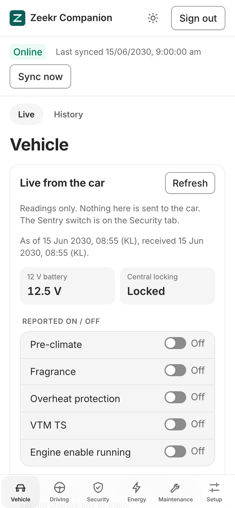 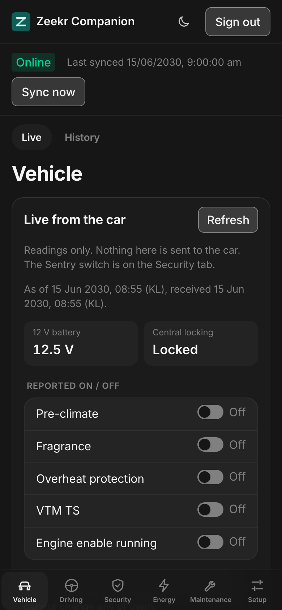 | 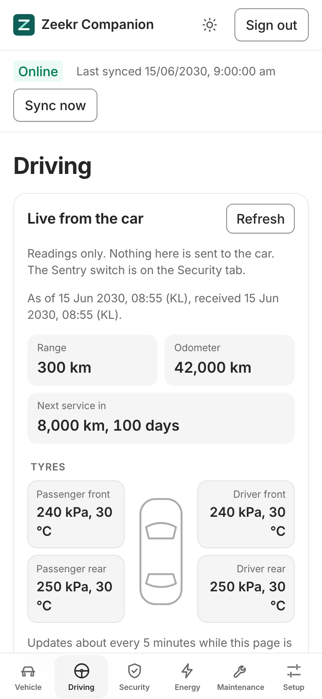 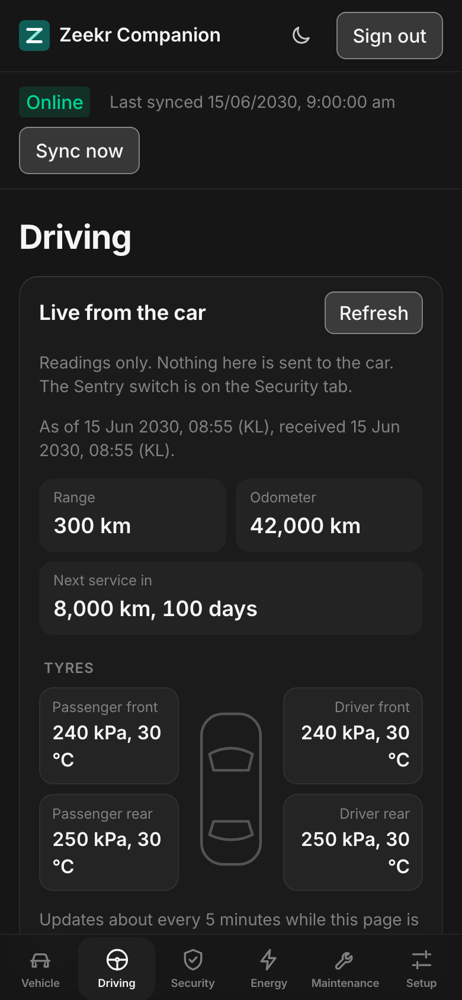 | 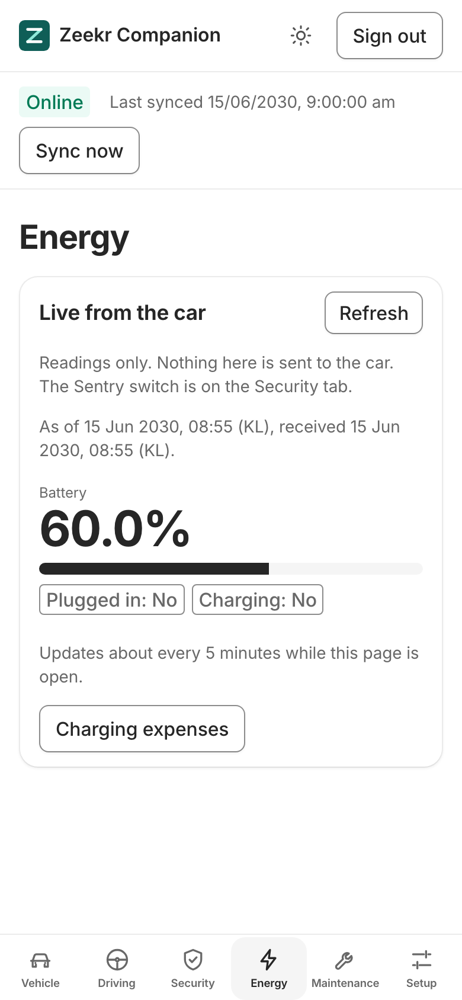 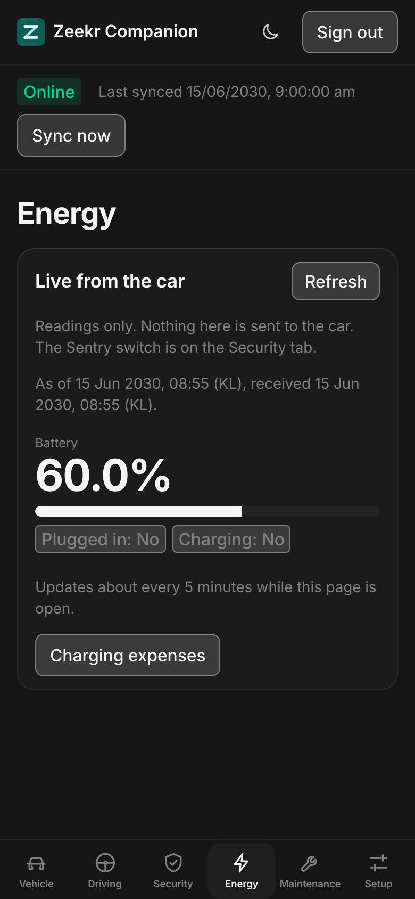 |
| 12 V battery, central locking and the car's reported on / off flags                                                                                           | Odometer, range, next service and tyres                                                                                                                       | Battery level, plugged in and charging                                                                                                                    |

| Maintenance: Service                                                                                                                                                                          | Maintenance: Reminders                                                                                                                                                |
| --------------------------------------------------------------------------------------------------------------------------------------------------------------------------------------------- | --------------------------------------------------------------------------------------------------------------------------------------------------------------------- |
| 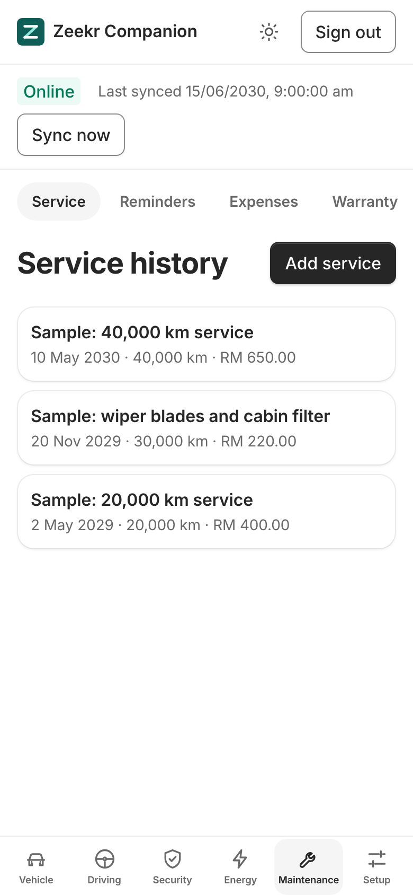 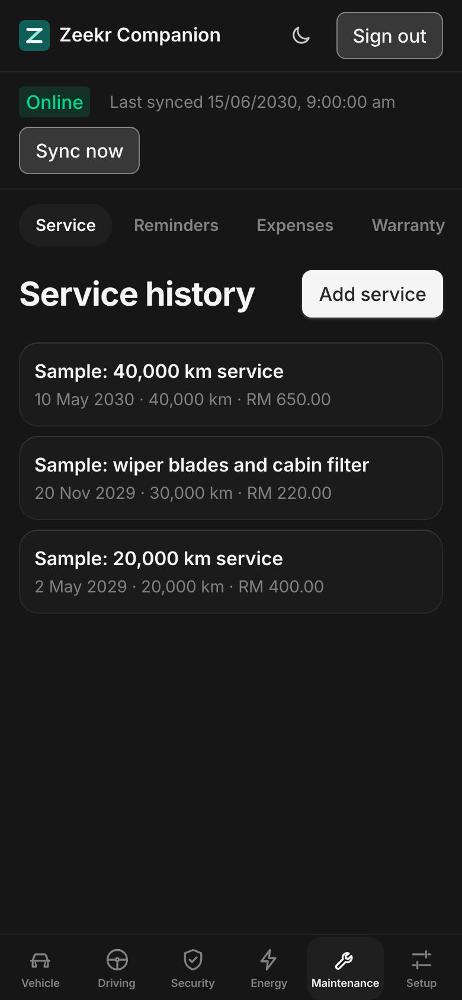 | 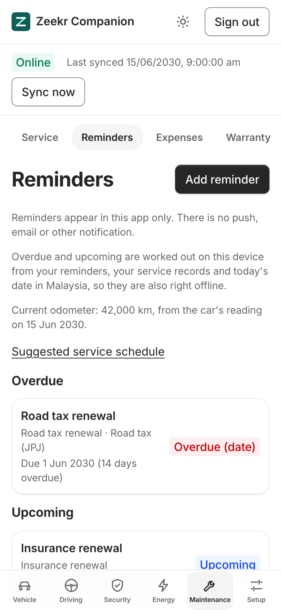 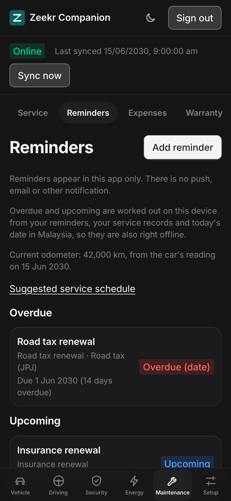 |
| Service records, newest first                                                                                                                                                                 | Overdue and upcoming, by date and odometer                                                                                                                            |

| Security: Sentry                                                                                                                                          | Security: Geofence                                                                                                                                                |
| --------------------------------------------------------------------------------------------------------------------------------------------------------- | ----------------------------------------------------------------------------------------------------------------------------------------------------------------- |
| 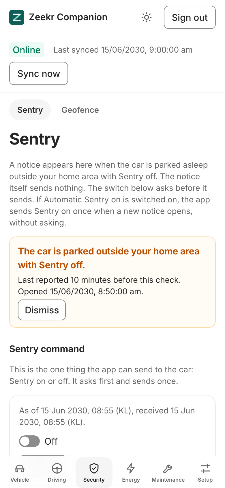 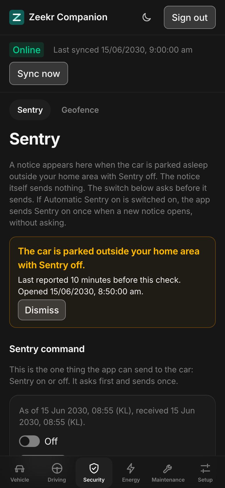 | 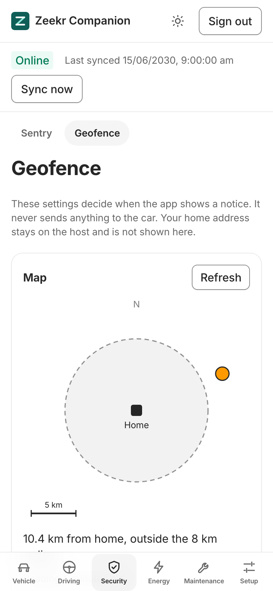 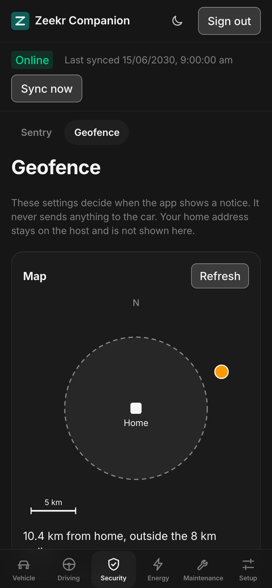 |
| A geofence notice and the Sentry switch, which asks before it sends                                                                                       | The map: home, an optional office, their radii and the car's distance from home. No street map or coordinates.                                                    |

## How it is built

- **Client:** React, Vite and TypeScript PWA (`apps/web`), served same-origin through a Caddy container.
- **API:** Python, FastAPI and PostgreSQL (`services/api`), with database migrations.
- **Run:** Docker Compose on one Ubuntu host (`infra/`).
- **Live data:** an unofficial client for the Zeekr app's interface. It is optional, read-only apart from Sentry, and uses a second Zeekr account.

## Installation

You need a Linux host with Docker Engine and the Compose plugin. The app has no firewall of its own, and the web port speaks plain HTTP. Keep it on a private network and never expose it to the internet.

### Option A: published images (one compose file, no build)

The images are `linux/amd64` and `linux/arm64` (releases up to `v0.1.3` are `linux/amd64` only). Check with `uname -m`: `x86_64` or `aarch64` works, 32-bit ARM (`armv7l`) does not.

1. Make a folder and download four files from `infra/` into it: `docker-compose.release.yml` (save it as `docker-compose.yml`), `.env.example`, `install.sh` and `update.sh`. Download the raw files, not GitHub's web page for them (a saved web page makes the script fail with `<!DOCTYPE html>`). For example: `curl -fsSL -o install.sh https://raw.githubusercontent.com/patcsy88/zeekr-companion/<release tag>/infra/install.sh`, and the same with `update.sh`, `.env.example` and `docker-compose.release.yml` (`-o docker-compose.yml`). Then run `chmod +x install.sh update.sh`.
2. Run `./install.sh --version <release tag>`, for example `--version v0.9.12` (the release tags are listed under Tags on GitHub). A bare `./install.sh` only prints the help. With `--init` and no `--version` it shows the latest release tag and asks y/n before using it (any answer but `y` stops with nothing changed; with no terminal or no network it asks you to pass `--version`). It writes `.env` with random `POSTGRES_PASSWORD` and `TOKEN_SECRET` values, never prints them, and sets the file to mode 600. First it prints the system (Linux distro and CPU) and checks that Docker and the Compose plugin work; if not, it stops with nothing changed and prints how to install them (it never runs `sudo` or installs anything itself). It refuses to run if `.env` already exists, because a new database password would lock the app out of an existing database.
3. Run `docker compose up -d --wait`. Or add `--start` to step 2 (`./install.sh --version <release tag> --start`): it then does steps 3 and 4 for you, waits up to `WAIT_SECONDS` (default 180) for the containers to be healthy, runs `set_owner` so you type the username and password (there is no default login), asks y/n about the optional authenticator step, then y/n about the optional Tailscale sidecar for private HTTPS on your phone (it asks for a neutral machine name, refuses one containing `zeekr` and asks for another, up to 3 tries, confirms it, then starts the container; you open the Tailscale login link yourself). Run it in a private terminal.
4. Create the app login. It asks for a username and a password of at least 12 characters:
   `docker compose exec api python -m app.cli.set_owner`
   Optional second step (authenticator-app code, ADR-013): `docker compose exec api python -m app.cli.set_mfa`. See `docs/operations/deploy-guide.md`.

   After install, four stand-alone flags of `install.sh` (each runs alone, in a private terminal, and needs `.env` and a working Docker) cover the same steps: `./install.sh --user-reset` (create the owner login or reset its username and password), `--mfa-on`, `--mfa-off` and `--deploy-tailscale` (set up the sidecar or change its machine name). The first three need `api` running; `./install.sh --help` lists them.

5. Open the app on port 8080. By default it listens on `127.0.0.1` only. To reach it from your phone, read `WEB_BIND_ADDRESS` in `docs/operations/deploy-guide.md` first.
6. To check which copy of a script you have, run `./install.sh --script-version` or `./update.sh --script-version`; the version is also the first line each script prints. Both scripts add a note, with a `curl` line for the newer copy, when the newest release is newer than the script. To update later, run `./update.sh --restart` (a bare `./update.sh` only prints the help, and there is no look-only mode: answer `n` to change nothing). It shows the version in `.env`, the running version and the newest release, which it always updates to, and asks y/n before changing anything; a database migration adds a second question about a fresh encrypted export. It refuses to go to an older version. It draws a small braille progress bar for each image pull and waits up to 180 seconds for the containers to be healthy; change `WAIT_SECONDS` in the script, or run `WAIT_SECONDS=300 ./update.sh --restart`, on a slow host.

There is no `latest` tag. To update, set `ZEEKR_VERSION` in `.env` to the new tag, then run `docker compose pull` and `docker compose up -d --wait`.

### Option B: from a clone (builds on the host)

1. Clone the repository and go into `infra/`.
2. Run `./install.sh --init`.
3. Run `docker compose up -d --build --wait`.
4. Create the app login as in Option A, step 4.

To update, run `git pull`, then `docker compose up -d --build --wait` again. A release that adds a database migration needs a fresh encrypted export first.

Back up `.env` somewhere private. It cannot be recovered, and it must never be committed or pasted anywhere. Two installs on one machine share the same compose project name, so give the second one a different project name, port and subnet. Details, backups and rollback are in `docs/operations/deploy-guide.md`.

## Live car data from a second Zeekr account (optional)

Live readings, the geofence notice and the Sentry switch stay off until you set this up. They use an **unofficial** client, not a supported Zeekr interface. Zeekr's terms on this are not confirmed, and the account can be restricted. Read `docs/architecture/decisions/ADR-009-live-zeekr-provider.md` first.

**Use a second Zeekr account, never your main one.** Each call by the client logs the phone app out unless the car is shared to another account.

1. Create a second Zeekr account and share the car to it. The account name is sent as an email, so use an email-based account.
2. Get six values from the Zeekr phone app: an HMAC access key, an HMAC secret key, a password public key, a production signing secret, a VIN key and an IV. Extracting them is left to you. ADR-009 describes the extractor that was used. It can print several candidates for the signing secret, and a wrong one fails the login. Each try is a full login on the second account.
3. In the host `.env` only, set `ZEEKR_USERNAME`, `ZEEKR_PASSWORD`, `ZEEKR_COUNTRY_CODE` (`MY` for a Malaysian account) and the six values `ZEEKR_HMAC_ACCESS_KEY`, `ZEEKR_HMAC_SECRET_KEY`, `ZEEKR_PASSWORD_PUBLIC_KEY`, `ZEEKR_PROD_SECRET`, `ZEEKR_VIN_KEY` and `ZEEKR_VIN_IV`. Then set `ZEEKR_LIVE_ENABLED=true` and run `docker compose up -d`. If any value is missing, the API refuses to start and names the setting, never a value.
4. Never put these values in the repository, in chat, in logs or in an issue.

Risks: a wrong password can cause up to five login attempts on the second account before the app stops trying, which could lock it. The client can break without notice.

## Start here

- `AGENTS.md`: operating principles and approval gates
- `docs/product/`: brief and requirements
- `docs/architecture/`: architecture, API contracts, ADRs
- `docs/operations/deploy-guide.md`: install, update, back up and roll back
- `docs/testing/test-strategy.md`: quality gates
- `docs/research/vehicle-integrations.md`: integration research

## Working with the agent team

Run `opencode` in this directory. The default agent is `engineering-lead`, which delegates to the subagents in `.opencode/agents/`.

## Public repository rules

This repository is public. It holds no secrets, VIN, plate, home address, host or network names, or readings from the car. Real values live only in the host `.env`.
